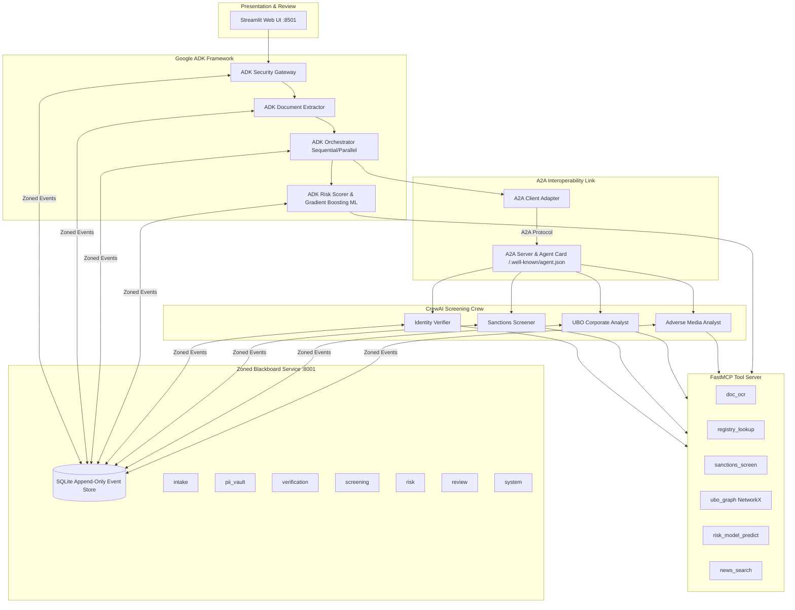

# OnboardIQ: Autonomous Multi-Agent KYC/AML Platform

[](https://www.python.org/downloads/)
[](https://github.com/astral-sh/ruff)
[](https://docs.pytest.org/)
[-lightgrey.svg)](AGENTS.md)

**OnboardIQ** is an autonomous multi-agent Know Your Customer (KYC) and Anti-Money Laundering (AML) client onboarding system built for institutional compliance. Designed strictly within **Google ADK** and **CrewAI**, OnboardIQ features a zoned, versioned, append-only **Blackboard Service**, an **A2A (Agent-to-Agent)** inter-framework protocol link, **FastMCP** tool mediation, strict **PII Vault containment**, and an interactive **Streamlit** compliance portal.

---

## 🏛️ System Architecture



---

## 🚀 Quickstart: Clean Clone Setup

### Prerequisites
- Python 3.11 or 3.12
- Git

### 1. Clone & Setup Virtual Environment
```bash
git clone <YOUR_REPO_URL> onboardiq
cd onboardiq

# Create virtual environment
python -m venv .venv

# Activate virtual environment (Windows PowerShell)
.venv\Scripts\Activate.ps1
# Or macOS/Linux:
# source .venv/bin/activate

# Install dependencies
pip install -r requirements.txt
pip install -e .
```

### 2. Configure Environment
```bash
cp .env.example .env
```
*(No external API keys are strictly required to run offline benchmark suites; all synthetic tools and deterministic mock models run locally.)*

### 3. Generate Benchmark Dataset & Train Baseline ML Model
```bash
# Generate 10 synthetic benchmark cases, mock registry DB, and document images
python scripts/generate_dataset.py

# Train baseline risk gradient boosting model
python scripts/train_risk_model.py
```

### 4. Run Automated Test Suite
```bash
# Execute unit and integration tests (62+ tests)
pytest -v --tb=short

# Verify code formatting and linting
ruff check .
```

---

## 🖥️ Running the Application

### Option A: Interactive Web UI (Streamlit)
Launch the comprehensive onboarding portal, live blackboard inspector, and compliance officer review console:
```bash
streamlit run src/onboardiq/ui/app.py
```
Open **[http://localhost:8501](http://localhost:8501)** in your browser.

### Option B: Blackboard REST Service (FastAPI)
Run the standalone zoned blackboard service:
```bash
uvicorn onboardiq.blackboard.service:app --host 127.0.0.1 --port 8001 --reload
```
Interactive Swagger documentation is available at **[http://127.0.0.1:8001/docs](http://127.0.0.1:8001/docs)**.

### Option C: CLI Case Runner
Execute a specific onboarding case directly in terminal:
```bash
# Run case_001 in Blackboard mode with Parallel pattern
python scripts/run_case.py --case case_001 --mode blackboard --pattern parallel

# Run case_008 (High-Risk Corporate UBO) in Hybrid P2P mode
python scripts/run_case.py --case case_008 --mode hybrid_p2p --pattern sequential
```

### Option D: Telemetry & Traces Inspector
Inspect step-by-step agent execution latencies, token consumption, and model cost:
```bash
python scripts/show_traces.py
```

### Option E: Evaluation Grid Sweep
Execute the benchmark evaluation matrix and produce metrics & charts:
```bash
python scripts/run_eval.py --config configs/eval_v0.yaml
```
Outputs:
- `results/metrics.csv`
- `results/plots/runtime_by_pattern.png`
- `results/plots/agent_phase_heatmap.png`

---

## 🔒 Security & Guardrails

- **Zero Auto-Reject:** The system architecturally forbids automated rejection. High-risk profiles, true sanctions hits, or unresolved red flags enforce `requires_human=True` and escalate to the Compliance Officer Console.
- **Strict PII Vault Isolation:** Sensitive personal identifiers (PAN, Passport numbers, DOB) are stored solely in the `pii_vault` zone. Downstream agents interact exclusively with SHA-256 masked tokens (`TOKEN-PAN-1234`).
- **PII Outbound Guard:** Intercepts outbound tool queries and blocks any request containing raw personal identifiers.
- **Input Guard:** Intercepts prompt injection payloads (`ignore instructions`, `VIP approval override`), logs a `GuardrailEvent`, and neutralizes the attack.

---

## 📂 Project Structure

```
OnBoardIQ/
├── configs/                # Evaluation grids and model configurations
├── data/                   # Synthetic cases, mock registry DB, sample lists
│   ├── cases/              # Labelled test cases (case_001 to case_010)
│   ├── models/             # Trained GradientBoostingClassifier model
│   └── news/               # Adverse media local corpus
├── docs/                   # Engineering specifications (BRD, PRD, Architecture, Security, Eval)
│   └── submission/         # Milestone M1 submission documents (Problem Statement, Plan, WIP, Slides)
├── results/                # Benchmark metrics CSV and runtime plots
├── scripts/                # CLI runners, trace viewers, and smoke tests
├── src/onboardiq/          # Core Python Package
│   ├── agents/
│   │   ├── adk/            # Gateway, Extractor, Orchestrator, Risk Scorer
│   │   └── crewai/         # Screening Crew, UBO Analyst, A2A Server
│   ├── blackboard/         # FastAPI Blackboard service, SQLite store, Client
│   ├── eval/               # Grid runner, metrics computer, plot generator
│   ├── guardrails/         # Input, PII, and Output security guards
│   ├── mcp_server/         # FastMCP tool server and modular tools
│   ├── messaging/          # Blackboard vs Hybrid P2P strategies
│   ├── telemetry/          # StepTrace callbacks and cost estimator
│   └── ui/                 # Streamlit web application
└── tests/                  # Pytest test suite (62+ tests)
```

---

## 📜 Academic Integrity & Synthetic Data Policy

This project strictly adheres to academic integrity and data privacy standards:
1. **Synthetic Data Only:** All applicants, corporations, identity numbers, and documents are 100% synthetically generated via `Faker` and PIL. No real personal data or government APIs are ever accessed.
2. **Framework Boundaries:** Only **Google ADK** and **CrewAI** are utilized. No secondary agent wrappers (LangChain, AutoGen, LlamaIndex) exist in the codebase.
