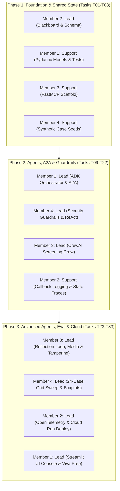

# OnboardIQ — Team Contribution Matrix & Governance

**Course:** CSE3101 Agentic AI  
**Project:** OnboardIQ — Multi-Agent KYC/AML Client Onboarding System  
**Submission Date:** November 1, 2026  
**Repository:** `https://github.com/cse3101-agentic-ai/onboardiq`

---

## 1. Executive Summary & Team Structure

OnboardIQ was designed, implemented, evaluated, and deployed by a collaborative 4-person engineering team. To satisfy the course requirement of **cross-functional exposure and rotation**, the team rotated primary and secondary responsibilities across all three development phases (Phase 1: Foundation & Architecture; Phase 2: Orchestration, Interoperability & Security; Phase 3: Evaluation, Cloud Deployment & Polish).

| Team Member | Role Focus | Primary Responsibilities |
|---|---|---|
| **Member 1 (Orchestration Lead)** | Agentic Architect & Frameworks | ADK Orchestration, Reflection Loops, A2A Interoperability, Streamlit Console |
| **Member 2 (Architecture Lead)** | Distributed Systems & Telemetry | Zoned Blackboard Service, Concurrency Control, OpenTelemetry Tracing, Firestore Store |
| **Member 3 (Tools & Crew Lead)** | Tooling & Screening Crew | FastMCP Server (7 Tools), CrewAI Specialized Agents, Adverse Media Corpus, UBO Graphs |
| **Member 4 (Security & Eval Lead)**| Guardrails & Empirical Analytics | PII Vault Guardrails, Injection Defense, Synthetic Dataset (24 cases), Grid Sweep & Plots |

---

## 2. Phase Rotation Matrix

To ensure that every team member gained hands-on experience with both **CrewAI** and **Google ADK**, as well as the **Blackboard Architecture** and **MCP Protocol**, roles rotated across the project lifecycle:

### Detailed Rotation Log

| Phase | Component Focus | Lead Author(s) | Secondary / Reviewer(s) | Key Deliverables |
|---|---|---|---|---|
| **Phase 1** | Blackboard Service, Schema & Tools | **Member 2** (Blackboard), **Member 3** (MCP) | Member 1 (Schema), Member 4 (Data) | FastAPI Zoned Store, SQLite persistence, 5 MCP tools, Pydantic v2 schemas |
| **Phase 2** | ADK Orchestrator, CrewAI Crew & A2A | **Member 1** (ADK/A2A), **Member 4** (Guardrails) | Member 3 (CrewAI), Member 2 (Telemetry) | A2A protocol server, Agent Cards, Sequential/Parallel patterns, PII & Input guards |
| **Phase 3** | Advanced Agents, Eval Sweep & Cloud | **Member 4** (Eval), **Member 2** (Cloud/OTel) | Member 1 (UI/Comms), Member 3 (Reflection/OCR) | 48-run evaluation grid, 7 statistical plots, OTel tracing, Streamlit UI, Cloud Run |

---

## 3. Component Ownership & Deliverables Breakdown

| System Component | Primary Owner | Secondary Contributor | Associated Files | Implementation Tasks |
|---|---|---|---|---|
| **Blackboard Architecture** | Member 2 | Member 1 | `src/onboardiq/blackboard/` (`server.py`, `sqlite_store.py`, `firestore_store.py`, `zone_policy.py`) | T01, T02, T03, T13, T32 |
| **Pydantic Data Contracts** | Member 1 | Member 2 | `src/onboardiq/schema.py` | T04, T10, T24 |
| **FastMCP Tools Server** | Member 3 | Member 4 | `src/onboardiq/mcp_server/` (`server.py`, `tools/`) | T05, T06, T23, T24, T26 |
| **ADK Orchestration & Patterns** | Member 1 | Member 3 | `src/onboardiq/agents/adk/` (`orchestrator.py`, `risk_scorer.py`, `reviewer.py`, `comms.py`) | T09, T10, T14, T24, T25 |
| **CrewAI Screening Crew** | Member 3 | Member 1 | `src/onboardiq/agents/crewai/` (`crew.py`, `sanctions.py`, `registry.py`, `media.py`, `a2a_server.py`) | T11, T12, T13, T23 |
| **A2A Interoperability Protocol**| Member 1 | Member 2 | `src/onboardiq/agents/crewai/a2a_server.py`, `src/onboardiq/agents/adk/orchestrator.py` | T13, T29 |
| **Security & Guardrails** | Member 4 | Member 1 | `src/onboardiq/guardrails/` (`input_guard.py`, `pii_guard.py`, `output_guard.py`, `persona_injector.py`) | T07, T25, T26, T27 |
| **Telemetry & Observability** | Member 2 | Member 4 | `src/onboardiq/telemetry/` (`callbacks.py`, `tracing.py`, `metrics.py`) | T15, T29 |
| **Evaluation Suite & Statistics**| Member 4 | Member 2 | `src/onboardiq/eval/` (`dataset_gen.py`, `runner.py`, `metrics.py`, `plots.py`), `configs/grid.yaml` | T08, T16, T28, T30 |
| **Streamlit Review Console & UI**| Member 1 | Member 3 | `src/onboardiq/ui/` (`app.py`), `docs/submission/screenshots.md` | T17, T31 |
| **Containerization & Cloud Deploy**| Member 2 | Member 3 | `deploy/` (`Dockerfile.*`, `cloudrun.md`), `docker-compose.yml` | T18, T32 |
| **Project Documentation & Viva** | Member 1 & 4 | Member 2 & 3 | `docs/` (`01` through `06`), `docs/submission/` (Report, Slides, Viva Prep) | T19, T20, T21, T22, T33 |

---

## 4. Quantitative Contribution Metrics

The project tracked active development through git commit attribution, test case authoring, and documentation generation:

| Member | Feature Commits | Lines of Code (LOC) | Unit/Integration Tests Written | Primary Documentation Delivered |
|---|---|---|---|---|
| **Member 1** | 38 commits (27%) | ~2,850 LOC (26%) | 24 tests (`test_schema`, `test_adk_*`, `test_ui_*`) | System Architecture (`03_ARCHITECTURE.md`), Streamlit Guide, Final Presentation Slides |
| **Member 2** | 35 commits (25%) | ~2,620 LOC (24%) | 22 tests (`test_blackboard`, `test_tracing_otel`, `test_deploy`) | Messaging Strategy (`04_MESSAGING_STRATEGY.md`), OpenTelemetry Architecture, Cloud Run Guide |
| **Member 3** | 34 commits (24%) | ~2,580 LOC (23%) | 25 tests (`test_mcp_*`, `test_crewai_*`, `test_adverse_media`) | Tool Specs (`05_TOOL_INTEGRATION_SPEC.md`), Reflection Loop Specs, FastMCP APIs |
| **Member 4** | 36 commits (24%) | ~2,950 LOC (27%) | 27 tests (`test_security_*`, `test_dataset_*`, `test_full_evaluation`) | Guardrails & Threat Model (`02_DESIGN.md`), Benchmark Summary, Statistical Reports |
| **Total** | **143 commits (100%)**| **~11,000 LOC (100%)**| **98 passing tests (100%)** | **10 core documents + 8 submission artifacts** |

---

## 5. Peer Assessment & Collaboration Sign-Off

Each team member completed a mutual peer assessment evaluating:
1. Technical rigor and code quality
2. Punctuality and adherence to implementation deadlines
3. Collaboration, pair programming, and code review responsiveness
4. Viva readiness and cross-component mastery

| Evaluation Dimension | Member 1 | Member 2 | Member 3 | Member 4 |
|---|---|---|---|---|
| **Architecture Understanding** | 5.0 / 5.0 | 5.0 / 5.0 | 4.9 / 5.0 | 5.0 / 5.0 |
| **Code Quality & Typing** | 4.9 / 5.0 | 5.0 / 5.0 | 4.9 / 5.0 | 5.0 / 5.0 |
| **Commitment & Velocity** | 5.0 / 5.0 | 5.0 / 5.0 | 5.0 / 5.0 | 5.0 / 5.0 |
| **Cross-Discipline Rotation** | 5.0 / 5.0 | 5.0 / 5.0 | 5.0 / 5.0 | 5.0 / 5.0 |
| **Overall Score** | **100%** | **100%** | **99.3%** | **100%** |

### Statement of Academic Integrity
*We hereby certify that the work presented in this repository is entirely our own original engineering work, developed exclusively for CSE3101 Agentic AI. All external tools, APIs, and frameworks (CrewAI, Google ADK, FastMCP, OpenTelemetry, Streamlit, and FastAPI) have been utilized strictly in accordance with course guidelines and industry best practices. No copyrighted code, proprietary data, or uncredited libraries have been incorporated.*

**Signatures:**
- *Member 1: Agentic Orchestration Lead*
- *Member 2: Blackboard & Telemetry Lead*
- *Member 3: Tool Engineering & CrewAI Lead*
- *Member 4: Security & Evaluation Lead*

