# OnboardIQ — Updated Project Plan (Milestone M1 Submission)

**Project:** OnboardIQ (CSE3101 Agentic AI — Project 2)  
**Submission Date:** November 6, 2026 (Updated as of Nov 1, 2026)  
**Status:** Milestone M1 Core Complete, Early UI Prototype Functional, Final Phase Scoped

---

## 1. Project Overview & Current Status

OnboardIQ is an autonomous multi-agent client onboarding (KYC/AML) system evaluating individual applicants and corporate entities. The project integrates **Google ADK** (orchestration, extraction, risk scoring) and **CrewAI** (identity verification, sanctions screening, UBO graph analysis) communicating over **A2A (Agent-to-Agent)** protocol, with external tool access mediated exclusively by a **FastMCP** server and shared state coordinated via an append-only, zoned **Blackboard** service.

As of November 1, 2026, **Milestone M1 deliverables (Tasks T01–T17) are 100% complete and verified**, with an early implementation of the Web UI (T31) operational for live demonstrations.

### Current Verification Metrics:
- **Unit & Integration Test Suite:** 62 passing tests (`pytest -v --tb=short`).
- **Static Analysis & Linting:** 100% clean (`ruff check .` with 0 warnings/errors).
- **Evaluation Benchmark:** 10/10 successful runs across Sequential/Parallel patterns and Blackboard/Hybrid P2P modes with 100% decision and tier accuracy against ground truth.

---

## 2. Work Completed (Milestone M1 — Oct 31 to Nov 5)

| Task ID | Task Description | Deliverable / Artifact | Verification Status |
|---|---|---|---|
| **T01** | Project skeleton & environment | Directory structure per Architecture §11, `pyproject.toml`, `.gitignore` | `pytest` and `ruff check .` passing |
| **T02** | Typed Schema Contract | `src/onboardiq/schema.py` (Pydantic v2 models, `DecisionDraft`, `Blackboard`) | 20 schema validator tests passing |
| **T03** | Blackboard Service | FastAPI app, SQLite store, access matrix, versioned events, `BlackboardClient` | 6 unit tests passing (read/write, 403, 409 concurrency) |
| **T04** | Synthetic Data Generator | 10 benchmark cases (`data/cases/`), rendered IDs (`data/docs/`), `registry.db` | 4 unit tests passing, valid PIL image renders |
| **T05** | FastMCP Tool Server | FastMCP server exposing `registry_lookup`, `sanctions_screen`, `doc_ocr`, `risk_predict` | 7 tool tests passing; smoke test verified |
| **T06** | ADK Extractor & Gateway | `agents/adk/gateway.py` and `extractor.py` writing intake, vault, verification | Field extraction with `EvidenceRef` passing |
| **T07** | CrewAI Screening Crew | `agents/crewai/screening_crew.py` (Identity Verifier, Sanctions Screener) | Automated verification & fuzzy matching passing |
| **T08** | A2A Protocol Link | `agents/crewai/a2a_server.py`, Agent Card at `/.well-known/agent.json` | Remote A2A invocation verified with StepTrace |
| **T09** | ADK Sequential Orchestrator | `agents/adk/orchestrator.py`, phase control, `OnboardingReport` generation | Full pipeline execution on individual & corporate cases |
| **T10** | ML Risk Model & Scorer | Gradient Boosting classifier (`data/models/`), `adk.risk_scorer`, `DecisionDraft` | Tier and factor scoring with cited evidence IDs |
| **T11** | Security Guardrails v1 | Input guard (injection, toxicity), PII guard, Output guard (no auto-reject) | 5 dedicated security tests passing |
| **T12** | Callbacks & Step Traces | `telemetry/callbacks.py`, `cost.py`, `scripts/show_traces.py` | Traces written to `system.traces` from both frameworks |
| **T13** | Parallel Execution Pattern | Concurrent ThreadPool dispatch for verification and screening, 409 retry | Parallel vs Sequential equivalence verified |
| **T14** | Hybrid P2P Messaging Mode | `MessagingStrategy` (`BlackboardStrategy` vs `HybridP2PStrategy`) | All 4 (mode × pattern) combinations produce valid reports |
| **T15** | Corporate UBO Path | `ubo_graph` FastMCP tool (NetworkX) and `crewai.ubo_analyst` | 4 tests passing (`case_007`, `case_008`, `case_009`) |
| **T16** | Evaluation Runner v0 | `eval/runner.py`, `metrics.py`, `plots.py` (runtime boxplot, phase heatmap) | 10/10 grid sweep completed, plots saved in `results/` |
| **T17** | Updated Problem Statement | `docs/submission/problem_statement.md` | Complete 1-page milestone document |
| **T31** | Interactive Web UI (Early) | `src/onboardiq/ui/app.py` (Streamlit portal, live board, officer console, analytics) | Running live on `http://localhost:8501` |

---

## 3. Work In Progress (Milestone M1 Submission Closeout)

- **T18 Updated Plan:** `docs/submission/project_plan.md` (this document).
- **T19 Work-in-Progress Report:** `docs/submission/wip_report.md` detailing architecture, verified empirical benchmark data, and resolution of engineering challenges.
- **T20 Coverage Slide Content:** `docs/submission/coverage_slide.md` summarizing progress against the 11 course criteria.
- **T21 Demo Rehearsal Script:** `docs/submission/demo_script.md` containing a 5–7 minute walkthrough and 10 anticipated viva questions.
- **T22 GitHub Audit:** Pre-push audit checking for zero API keys, no `.env`, synthetic data only, clean clone verification.

---

## 4. Final Phase Roadmap (Nov 7 – Final Course Submission)

The remaining tasks advance OnboardIQ from Milestone M1 to the full production-grade, audited implementation:

```mermaid
flowchart LR
    subgraph W1[Week 1: Advanced Intelligence & Loops]
        T23[T23: Adverse Media Agent & Corpus]
        T24[T24: Compliance Reviewer & Reflection Loop]
        T25[T25: Client Communicator & RFI Loop]
        T26[T26: Tamper Score & Forgery Detection]
    end

    subgraph W2[Week 2: Adversarial Hardening & Large Dataset]
        T27[T27: Persona Injections & Prompt Variants]
        T28[T28: Full 24-Case Synthetic Dataset]
        T29[T29: OpenTelemetry & Langfuse Tracing]
    end

    subgraph W3[Week 3: Empirical Rigor & Cloud Deployment]
        T30[T30: Full 40+ Evaluation Sweep & Statistics]
        T32[T32: Google Cloud Run Multi-Container Deploy]
        T33[T33: Final Research Report & Defense]
    end

    W1 --> W2 --> W3
```

### Detailed Final Phase Task Breakdown:

1. **Week 1 (Nov 7 – Nov 13): Intelligent Decision Loops & Media**
   - **T23 Adverse Media Agent:** Local news corpus (`data/news/`), relevance scoring, entity disambiguation, and media red flag generation.
   - **T24 Reviewer Agent & Reflection Loop:** 15-rule policy document (`data/policy.md`), `policy_rag` tool, ADK reviewer challenging risk drafts with max 2 revision cycles.
   - **T25 Client Communicator & RFI Loop:** Automated Request for Information (RFI) for missing/low-confidence docs; neutral de-escalation for abusive personas.
   - **T26 Tamper Score & Forger Detection:** Image error-level analysis and metadata checks in OCR; document tampering red flags.

2. **Week 2 (Nov 14 – Nov 20): Robustness, Scale & Observability**
   - **T27 Persona Injection Suite:** 4 variants per persona (cooperative, impatient, abusive, forger, injecting) across formal letters, form stuffing, and hidden text.
   - **T28 Full Labelled Dataset (24 Cases):** Expand dataset with real public OFAC/UN lists and public PEP records with reproducible random seeds.
   - **T29 Enterprise Tracing:** Wire OpenTelemetry across ADK, CrewAI, and FastMCP to export unified traces to Langfuse/Phoenix.

3. **Week 3 (Nov 21 – Final Deadline): Evaluation Sweep, Cloud & Final Viva**
   - **T30 Full Evaluation Grid:** Execute $\ge 40$ runs sweeping modes, patterns, personas, and reasoning styles. Statistical hypothesis testing (Mann-Whitney / Bootstrap).
   - **T32 Google Cloud Run Deployment:** Multi-container deployment (Blackboard service, FastMCP tool server, A2A CrewAI service, ADK Orchestrator, Streamlit UI) with Secret Manager.
   - **T33 Final Report & Viva Presentation:** Course-formatted comprehensive report, contribution matrix, presentation slide deck, and defense preparation.

---

## 5. Team Responsibility & Rotation Matrix

To satisfy course guidelines, technical roles rotate across milestones to ensure full cross-functional understanding across blackboard state, agent frameworks, security guardrails, and evaluation.

| Team Member | Phase 1 (M1: Foundations & Core) | Phase 2 (Advanced Intelligence & Loops) | Phase 3 (Evaluation, Cloud & Defense) |
|---|---|---|---|
| **Member 1 (Lead A)** | **Blackboard & Schema:** Store, schema validation, optimistic concurrency (T01–T03). | **CrewAI & Media:** Adverse media agent, news corpus, tamper detection (T23, T26). | **Evaluation & Statistics:** Full 40-run sweep, statistical hypothesis tests, plots (T30). |
| **Member 2 (Lead B)** | **ADK & Orchestration:** Extractor, Sequential/Parallel orchestrator, Risk model (T06, T09, T10, T13). | **Decision Loops & Policy:** Policy RAG, Reviewer reflection loop, RFI communicator (T24, T25). | **Cloud Deployment & Ops:** Cloud Run Dockerfiles, IAM, Secret Manager (T32). |
| **Member 3 (Lead C)** | **CrewAI, MCP & Telemetry:** FastMCP server, screening crew, A2A link, callbacks (T04, T05, T07, T08, T12). | **Security & Personas:** Persona injection suite, adversarial prompts, PII hardening (T27, T28). | **OpenTelemetry & UI:** Distributed tracing export, final UI enhancements, viva demo (T29, T31). |
| **Joint Pairing** | All members paired on A2A Integration (T08), Parallel Locking (T13), and Hybrid P2P (T14). | All members pair on Cross-Framework Reflection Loops (T24) and Tamper Verification (T26). | Entire team conducts mock viva rehearsals, code walkthroughs, and defense preparation (T33). |

---

## 6. Risk Management & Watchlist

1. **A2A Interoperability Stability:**  
   *Mitigation:* FastMCP and A2A interfaces are locked behind strict Pydantic v2 contracts; local mock agent fallback ensures CI tests execute independently of network latency.
2. **LLM Cost & Rate Limits (429):**  
   *Mitigation:* Token cost estimator is active; evaluations run on lightweight, deterministic local or cached LLM configurations; tool calls are memoized.
3. **No Private Agent State / PII Leaks:**  
   *Mitigation:* `input_guard` and `pii_guard` strictly gate all blackboard and tool queries; verified with automated unit tests.

