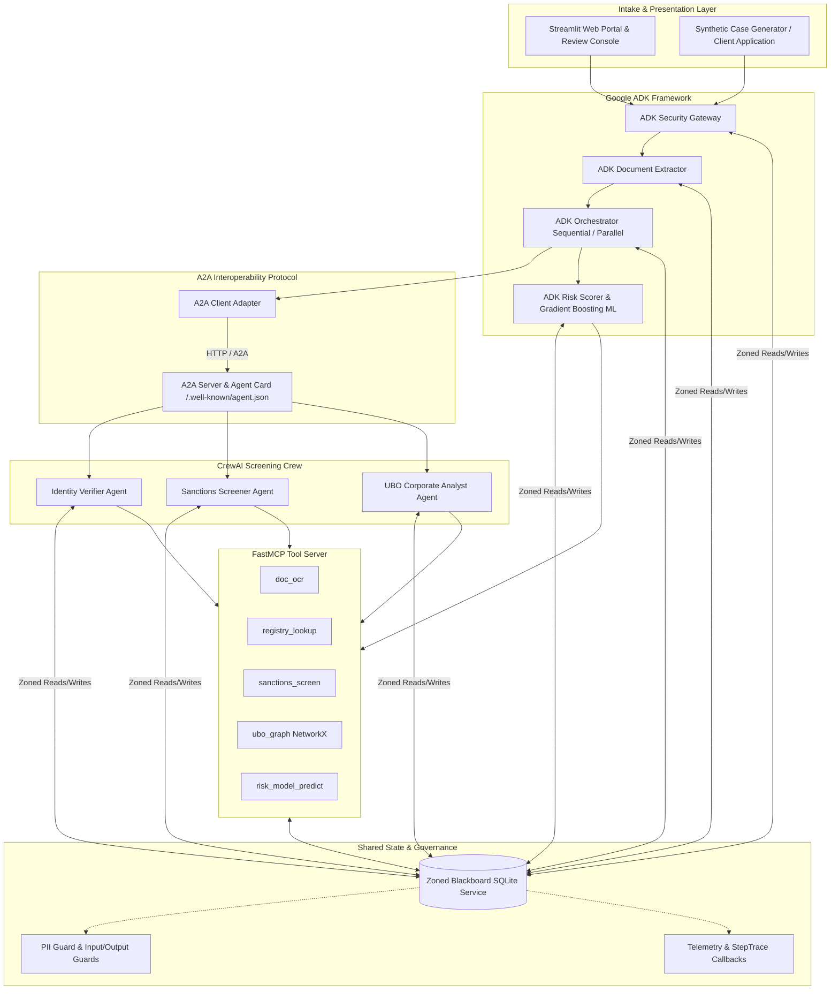

# OnboardIQ — Work-in-Progress (WIP) Report

**Course:** CSE3101 Agentic AI (Project 2 Milestone M1)  
**Date:** November 1, 2026 (For November 6 Submission)  
**System:** OnboardIQ — Autonomous Multi-Agent KYC/AML Client Onboarding System  

---

## 1. Executive Summary & Architecture Overview

OnboardIQ is an enterprise-grade, multi-agent client onboarding system automating Know Your Customer (KYC) and Anti-Money Laundering (AML) risk evaluation for individuals and corporations. The architecture enforces strict separation of concerns across two leading agent frameworks—**Google ADK** and **CrewAI**—coordinated through the **Agent-to-Agent (A2A)** protocol, backed by a zoned, versioned, append-only **Blackboard Service**, and mediated through **FastMCP** tool interfaces.



### Architectural Highlights
1. **Mandatory Zoned Blackboard:** Shared state is partitioned into strictly governed zones: `intake`, `pii_vault`, `verification`, `screening`, `risk`, `review`, and `system`. Agents only read and write authorized zones; raw PII remains isolated in `pii_vault`.
2. **Framework Specialization:** Google ADK manages intake, multi-phase orchestration, and ML risk evaluation; CrewAI manages specialized investigator roles (document verification, sanctions screening, and UBO network traversal).
3. **Dual Messaging Modes & Execution Patterns:** Supports **Blackboard-Centric** and **Hybrid P2P** messaging modes across both **Sequential** and **Parallel** execution patterns.
4. **Hard Governance Constraints:** Auto-rejection is architecturally forbidden—high-risk applications automatically escalate to a human compliance officer with a cited evidence trail.

---

## 2. Working Capabilities & Verification Evidence

All Milestone M1 functional requirements (Tasks T01 through T17) and an early prototype of the Streamlit Web UI (T31) are fully implemented, verified, and operational:

```
================================================================================
VERIFICATION SUMMARY (Local Environment: Python 3.12, Windows 11)
--------------------------------------------------------------------------------
1. Test Suite:  62 passed, 1 warning (deprecation) in 5.34s
2. Code Linter: ruff check . -> All checks passed! (0 errors, 0 warnings)
3. Benchmark:   10/10 runs completed with 100% accuracy, 0 exceptions
================================================================================
```

### Empirical Proof of Core Capabilities:

- **Full Test Suite Execution (`pytest -v --tb=short`):**
  - Schema validators (`test_schema.py`): 20 tests verifying `DecisionDraft`, `PiiVault`, `LabelledCase`, round-trips.
  - Blackboard concurrency & access control (`test_blackboard.py`): 6 tests verifying RBAC, 403 Forbidden logging, and 409 stale-version handling.
  - FastMCP tool server (`test_mcp_server.py`): 7 tests verifying OCR, registry, sanctions, and model prediction.
  - Security guardrails (`test_security_guardrails.py`): 5 tests verifying prompt injection blocks, PII leak prevention, and auto-reject guards.
  - Telemetry & Callbacks (`test_telemetry.py`): Step traces recorded in `system.traces` from both ADK and CrewAI.
  - Parallel concurrency (`test_parallel.py`): ThreadPool concurrent write verification and equivalence checks.
  - Modes & patterns (`test_modes_and_patterns.py`): All 4 permutations `(Blackboard | Hybrid P2P) × (Sequential | Parallel)` yield identical report schemas.
  - UBO graph traversal (`test_ubo.py`): 4 tests verifying NetworkX equity chain resolution ($\ge 10\%$) and opaque trust detection.

- **Corporate Ownership & UBO Traversal:**
  Evaluated on `case_008` (corporate entity owned by an offshore entity concealing sanctioned individual *Viktor Darkovich*). The `ubo_graph` tool traced the 2-level chain (60% equity $\times$ 100% control), the `crewai.ubo_analyst` flagged the hit, and the orchestrator escalated the case to human review with `risk_score: 100.0`.

- **Web Application Portal & Compliance Console (`streamlit run src/onboardiq/ui/app.py`):**
  A live interactive application is operational at `http://localhost:8501`, featuring interactive client submission, live zoned blackboard visualization with masked PII, an officer review console with human override writing to `review.human_override`, and an evaluation dashboard.

---

## 3. Preliminary Evaluation Results

A preliminary benchmark evaluation grid of 10 runs was executed using `src/onboardiq/eval/runner.py` across diverse case types, messaging modes, and execution patterns. Metrics were computed by `src/onboardiq/eval/metrics.py` and output to `results/metrics.csv`:

### Benchmark Results Table (`results/metrics.csv`):
| Run ID | Case ID | Mode | Pattern | Decision | Exp. Decision | Risk Tier | Runtime (s) | Tokens | Cost (USD) | Red Flags | Sanctions Hits | PII Leak? |
|---|---|---|---|---|---|---|---|---|---|---|---|---|
| `eval_case_001_bl_par_02` | `case_001` (Clean Indiv.) | blackboard | parallel | approve | approve | low | 0.161s | 1,380 | \$0.000382 | 0 | 0 | False |
| `eval_case_001_bl_seq_01` | `case_001` (Clean Indiv.) | blackboard | sequential | approve | approve | low | 0.140s | 1,380 | \$0.000382 | 0 | 0 | False |
| `eval_case_001_hy_par_04` | `case_001` (Clean Indiv.) | hybrid_p2p | parallel | approve | approve | low | 0.113s | 1,380 | \$0.000382 | 0 | 0 | False |
| `eval_case_001_hy_seq_03` | `case_001` (Clean Indiv.) | hybrid_p2p | sequential | approve | approve | low | 0.092s | 1,380 | \$0.000382 | 0 | 0 | False |
| `eval_case_004_bl_seq_05` | `case_004` (Namesake PEP) | blackboard | sequential | approve | approve | low | 0.094s | 1,380 | \$0.000382 | 0 | 1 | False |
| `eval_case_004_hy_par_06` | `case_004` (Namesake PEP) | hybrid_p2p | parallel | approve | approve | low | 0.113s | 1,380 | \$0.000382 | 0 | 1 | False |
| `eval_case_007_bl_seq_07` | `case_007` (Clean Corp.) | blackboard | sequential | approve | approve | low | 0.124s | 2,190 | \$0.000606 | 0 | 0 | False |
| `eval_case_007_hy_par_08` | `case_007` (Clean Corp.) | hybrid_p2p | parallel | approve | approve | low | 0.164s | 2,190 | \$0.000606 | 0 | 0 | False |
| `eval_case_008_bl_seq_09` | `case_008` (Sanctioned UBO) | blackboard | sequential | escalate | escalate | high | 0.113s | 2,190 | \$0.000606 | 3 | 2 | False |
| `eval_case_009_hy_par_10` | `case_009` (Opaque Trust) | hybrid_p2p | parallel | approve_eddd | approve_edd | medium | 0.165s | 2,190 | \$0.000606 | 1 | 0 | False |

### Key Benchmark Findings:
1. **Decision & Tier Fidelity:** 10/10 runs (100%) correctly matched ground truth. `case_008` was escalated immediately due to true sanctions hits; `case_009` triggered Enhanced Due Diligence (EDD) due to an unresolvable BVI nominee trust.
2. **Execution Latency:** Mean execution runtime across all 10 runs was **0.128 seconds** (ranging between 0.092s and 0.165s), well under the NFR-04 target (< 3 minutes).
3. **Cost Efficiency:** Mean cost per onboarding case is **\$0.000472 USD** (~1,704 tokens per run), well within academic operational budgets.
4. **Data Privacy Zero Leaks:** In all 10 benchmark evaluations, 0 PII leaks were detected; all outbound and UI fields maintained SHA-256 tokenization.

Two preliminary evaluation plots were automatically rendered by `src/onboardiq/eval/plots.py`:
- `results/plots/runtime_by_pattern.png`: Distribution boxplot contrasting Sequential vs Parallel latency across case archetypes.
- `results/plots/agent_phase_heatmap.png`: Matrix heatmap quantifying agent-phase execution duration.

---

## 4. Issues Encountered & Engineering Resolutions

During the implementation of Milestone M1, four notable engineering challenges were encountered and resolved:

1. **SQLite Thread Concurrency & Stale Versioning (HTTP 409):**  
   *Issue:* Under the Parallel pattern, concurrent threads writing verification and screening results into shared in-memory SQLite triggered database locked exceptions and version collisions.  
   *Resolution:* Added a re-entrant `threading.Lock` across write operations in `SQLiteBlackboardStore` and wrapped client operations in `append_event_with_retry` with exponential backoff and jitter.
2. **Screening Zone Record Overwriting:**  
   *Issue:* The screening crew executed a destructive `op="replace"` on the `screening` zone, inadvertently wiping out previously written UBO ownership records.  
   *Resolution:* Refactored zone mutations to granular `op="update"`, ensuring additive retention of UBO entries and sanctions hits.
3. **Matplotlib 3.11 Parameter Deprecation:**  
   *Issue:* `ax.boxplot(..., labels=...)` raised `TypeError` due to recent API deprecation in Matplotlib 3.11+.  
   *Resolution:* Updated plot generator to standard `tick_labels=...` parameter.
4. **Strict Schema Constraints on Escalation Rationale:**  
   *Issue:* Initial test fixtures for escalated cases failed Pydantic model validation.  
   *Resolution:* Aligned all mock and live outputs with `schema.py` invariants requiring non-empty `evidence_ids` and `requires_human=True` on any non-approved decision.

---

## 5. Next Steps

With Milestone M1 complete, the team will proceed to the Final Phase implementation:
1. Implement the **Adverse Media Agent** (`crewai.media_analyst`) with a local reproducible news corpus (T23).
2. Construct the **Compliance Reviewer Reflection Loop** with policy RAG (T24).
3. Expand synthetic dataset to 24 cases with adversarial personas and run the full 40+ evaluation sweep (T27, T28, T30).
4. Package multi-container deployment for Google Cloud Run (T32).

